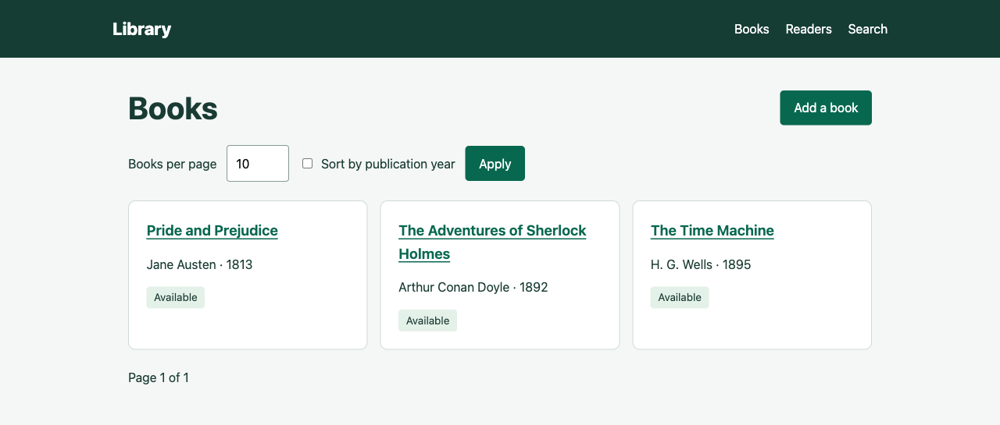

# Library

A small library lending application built with Spring Boot, Spring MVC, Thymeleaf and JPA. Manage books and readers, check books out and return them, search titles and browse stable pages. Originally based on Alishev's Spring course.



## Stack

- [Java 21](https://docs.oracle.com/en/java/javase/21/)
- [Spring Boot 3.5](https://docs.spring.io/spring-boot/3.5/index.html), Spring MVC and [Spring Security](https://docs.spring.io/spring-security/reference/servlet/exploits/csrf.html)
- [Spring Data JPA](https://docs.spring.io/spring-data/jpa/reference/) with Hibernate
- [Thymeleaf](https://www.thymeleaf.org/documentation.html)
- [Flyway](https://documentation.red-gate.com/flyway), [PostgreSQL 17](https://www.postgresql.org/docs/17/) and [H2](https://h2database.com/)
- JUnit 5, Mockito, MockMvc and Testcontainers

## Quick start without Docker

Prerequisites: Git, JDK 21 and a terminal. The Maven Wrapper downloads Maven on its first invocation. Use `mvn` instead of `./mvnw` if Maven is already installed; on Windows use `mvnw.cmd`.

```bash
git clone https://github.com/hawkxdev/SpringBootApp.git
cd SpringBootApp
./mvnw spring-boot:run
```

Open [http://localhost:8080/books](http://localhost:8080/books). The default `demo` profile creates an in-memory H2 database, applies Flyway migrations and loads two fictional readers and three books. No database installation or credentials are needed. Demo changes disappear when the process stops.

If the repository is private, cloning requires access granted by its owner. There is no hosted deployment.

## Run with PostgreSQL and Docker

Prerequisites: Git and Docker with Compose. No host JDK or Maven is needed.

```bash
git clone https://github.com/hawkxdev/SpringBootApp.git
cd SpringBootApp
cp .env.example .env
docker compose up --build -d
```

On Windows PowerShell use `Copy-Item .env.example .env` for the copy step. Replace the example `DB_PASSWORD` in `.env` with your own local password before starting. Compose creates the database itself; Flyway creates its schema on application startup. This profile starts with empty tables. PostgreSQL data survives container restarts in the `library-data` volume.

Open [http://localhost:18080/books](http://localhost:18080/books). The application port is bound to loopback and the database port is not published.

```bash
docker compose logs app
docker compose down
```

Removing the database volume would remove local records; normal `down` leaves it intact.

## Local JDK with an existing PostgreSQL database

Create the database before starting the app. For example, with PostgreSQL tools installed and a local role named `library`:

```bash
createdb -U library -O library library
export SPRING_PROFILES_ACTIVE=postgres
export DB_URL=jdbc:postgresql://localhost:5432/library
export DB_USER=library
read -s DB_PASSWORD
export DB_PASSWORD
./mvnw spring-boot:run
```

Enter that database role password at the `read` prompt. On PowerShell set the corresponding `$env:` variables instead. Flyway applies migrations automatically; Hibernate validates the resulting schema. Do not point this example at an existing production database.

| Setting | Purpose |
|---|---|
| `SPRING_PROFILES_ACTIVE` | `demo` by default; set `postgres` for persistent storage |
| `DB_URL`, `DB_USER`, `DB_PASSWORD` | PostgreSQL connection; the password has no application default |
| `APP_PORT` | Compose host port, default `18080` |
| `SERVER_PORT`, `SERVER_ADDRESS` | Native application HTTP binding; default `127.0.0.1:8080` |
| `LIBRARY_LOAN_PERIOD_DAYS` | Loan period, default 10 days |
| `LIBRARY_DEFAULT_PAGE_SIZE`, `LIBRARY_MAX_PAGE_SIZE` | Default 10 and maximum 100 books per page |

## Use the application

1. Open **Readers** and add a reader with a birth year. Reader names must be unique.
2. Open **Books** and add a title, author and publication year.
3. Open that book and select a reader to check it out.
4. Edit its title or author; this must preserve the borrower and checkout time.
5. Return the book before assigning another reader or deleting it. A reader with outstanding loans cannot be deleted.

A loan becomes overdue strictly after the configured duration, measured using UTC. Repeating checkout for the same reader does not restart the loan period. Search is case insensitive and limited to the configured maximum page size; lists have stable title/year and identifier ordering.

## Tests

Fast suite with an automatically migrated H2 database:

```bash
./mvnw clean verify
```

Real PostgreSQL integration suite, requiring a running Docker engine:

```bash
./mvnw verify -Ppostgres-it
```

The integration suite uses an isolated PostgreSQL container. Its concurrency scenario first holds the book row, starts two different readers, observes both blocked database writers and then releases the row. Exactly one checkout may succeed. The suite also checks schema-level checkout consistency.

The regular suite checks checkout and return, preservation of loan metadata during edits, duplicate readers, missing records, overdue boundaries, pagination, escaped stored input, field-binding restrictions and CSRF rejection. Test reports are written to `target/surefire-reports` and `target/failsafe-reports`.

## Structure

```text
src/main/java/.../Project2Boot/
  config/        Application settings, UTC clock and local form security
  controllers/   HTTP pages and controlled errors
  models/        Persistent books and readers
  repositories/  JPA queries and row locks
  services/      Transactional lending rules
  validation/    Calendar year validation
src/main/resources/
  db/migration/  Shared schema migrations
  db/demo/       Fictional demo data
  templates/     Server rendered pages
src/test/java/   Unit, HTTP and PostgreSQL integration tests
```

## Scope and design

This is a local educational demonstration, not an authenticated multi-user service. Anyone who can reach it can manage its records. CSRF protects forms; it does not grant user authorization. Keep it on loopback and use fictional data. The application deliberately has no accounts, public deployment, background jobs or GitHub Actions workflow.

Lending mutations lock existing rows inside transactions and recheck current state. Reader lifecycle operations and checkout use a consistent reader-before-book lock order. A database constraint keeps borrower and checkout timestamp either both present or both absent. Editing metadata changes the existing entity rather than replacing its lending state. Flyway owns schema changes; automatic schema mutation by Hibernate is disabled. Calendar validation uses the Bean Validation context clock and works in both MVC forms and JPA persistence callbacks.

## Maintainers

- [hawkxdev](https://github.com/hawkxdev)
